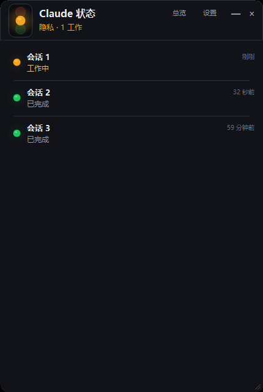
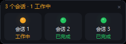

# Claude Traffic Light · Claude 状态红绿灯

中文 · [English](#english)

[](LICENSE)


> 一个常驻桌面最上层的 Windows 小工具：用红绿灯显示本机所有 **Claude Code** 会话的当前状态，
> 在某个会话**需要你回答 / 已完成 / 出错**时提醒你。支持总览窗、隐私模式、托盘与开机自启。
>
> An always-on-top Windows tray app that shows the live status of every local Claude Code
> session as a traffic light, and notifies you when a session needs input, finishes, or fails.

| 主窗口（隐私模式） | 总览窗（隐私模式） |
|---|---|
|  |  |

## 功能

- **一眼看全**：顶部一盏三色灯 + 会话列表；红=有人等你，黄=工作中，绿=都空闲，品红=出错。
- **逐会话查看**：每行显示标题、状态、项目名、最后活动时间；点开可看最后提问/回复、
  待办进度、模型、会话 ID、工作目录，并支持「复制会话 ID / 打开目录 / 跳到会话」。
- **总览窗**：每个会话一个小格子，点一下就切到该会话。
- **提醒**：进入「需要你回答 / 已完成 / 出错」时弹托盘气泡 + 提示音；只在状态跳变时提醒，
  点气泡直接打开并选中该会话。
- **隐私模式**：隐藏对话标题、项目名、提问、回复、目录和通知文案，只保留状态。
- **托盘常驻**：关闭窗口只是收进托盘；双击托盘图标再打开。
- **开机自启**：安装器可勾选，设置里也能随时开关。
- **安装与更新**：单文件安装包，支持首次选目录、覆盖升级和软件内更新。

## 安装

从 [Releases](../../releases) 下载 `ClaudeTrafficLightSetup.exe`：

1. 双击运行，选择安装目录（默认 `%LOCALAPPDATA%\Programs\ClaudeTrafficLight`，**不需要管理员权限**）；
2. 勾选是否创建桌面快捷方式、是否开机自启、是否安装完成后运行；
3. 安装完成后从桌面或开始菜单启动。

**覆盖升级**：直接运行新版本安装包即可，会沿用原安装目录，设置、钩子、开机自启都会保留。

**卸载**：Windows「设置 → 应用」里卸载，或运行安装目录下的 `uninstall.exe --uninstall`。
卸载会移除程序目录、快捷方式、注册表和本程序安装的 Claude 钩子；`%APPDATA%\ClaudeTrafficLight`
里的设置会保留，方便重装后沿用。

不想安装也可以直接运行 `ClaudeTrafficLight.exe`（免安装版）。

## 使用

### 红绿灯含义

| 颜色 | 含义 |
|---|---|
| 🔴 红 | 有会话正在等你回答（权限确认、选择、提问） |
| 🟠 黄 | 有会话正在工作 |
| 🟢 绿 | 有会话已完成 / 空闲 |
| 🟣 品红 | 有会话出错 |
| ⚪ 灰 | 已结束 |

### 精确状态（可选）

默认通过 Claude Code 自己的会话注册表判断「忙 / 空闲」。若想精确知道
「刚需要你回答 / 刚做完 / 刚出错」的瞬间，打开「设置 → 安装钩子」：

- 会给 `~/.claude/settings.json` 加 6 个生命周期钩子（先备份、只增不改、可一键卸载）；
- 已经开着的会话需要重开一次才会生效；
- 不装也完全可用，只是提醒文案会粗一些。

### 隐私模式

「设置 → 隐私模式」或托盘右键开关。开启后：

- 列表只显示「会话 1 / 会话 2 …」，不显示标题和项目名；
- 详情不显示最后提问 / 回复 / 工作目录；
- 总览窗只显示序号与状态；
- 托盘通知只显示「有会话需要你回答 / 已完成 / 出错」。

隐私模式是**显示层**开关：程序仍然在本地读取会话状态，但**不联网、不上传**。

## 检查更新

「设置 → 当前版本 → 检查更新」会读取更新源清单，发现新版本后依次：

1. 显示版本号与更新说明，确认后下载；
2. 校验 SHA256（清单里给了才校验）；
3. 调用安装包静默覆盖安装；
4. 自动重启。

官方发布版默认使用本仓库 Release 里的 `latest.json`。也可以自己配置：
`%APPDATA%\ClaudeTrafficLight\update.json` 或程序目录 `update.json`：

```json
{ "feedUrl": "https://your.server/claude-traffic-light/latest.json" }
```

清单格式：

```json
{
  "version": "0.2.1",
  "url": "https://your.server/ClaudeTrafficLightSetup.exe",
  "sha256": "可选；填了必须匹配",
  "notes": "更新说明",
  "mandatory": false
}
```

发版时运行 `tools\make-feed.ps1 -Url "<下载地址>" -Notes "<说明>"` 生成 `dist\latest.json`。

## 数据来源与隐私

程序只读取本机 Claude Code 的运行数据，**不修改**（安装钩子除外，且可卸载）：

| 来源 | 用途 |
|---|---|
| `%USERPROFILE%\.claude\sessions\<pid>.json` | 有哪些会话活着、忙 / 等 / 空闲、工作目录 |
| `%USERPROFILE%\.claude\projects\<slug>\<sessionId>.jsonl` | AI 标题、最后提问/回复、待办进度、API 错误 |
| 安装钩子后的 `Notification / Stop / ...` 事件 | 精确捕捉「刚需要你回答 / 刚做完 / 刚出错」 |

- **无遥测、无账号、无云端**；唯一的网络请求是你主动点「检查更新」时的更新源请求。
- 设置存放在 `%APPDATA%\ClaudeTrafficLight`，日志在 `%LOCALAPPDATA%\ClaudeTrafficLight`。
- 本项目与 Anthropic 无关；「Claude」是 Anthropic, PBC 的商标。

## 已知限制

- 只支持 Windows 10 / 11（依赖 .NET Framework 4.x，系统自带，无需安装运行时）。
- 「等待你回答」在未安装钩子时依赖 Claude Code 的会话注册表状态；某些权限模式（如 auto）
  可能不弹出确认框。
- 托盘气泡是否显示为通知中心消息，取决于 Windows 通知设置。
- 界面语言目前为中文。

## 构建

环境：Windows + .NET Framework 4.x（系统自带 `csc.exe`），**无 NuGet、无第三方依赖**。

```cmd
tools\build.cmd
```

产物在 `dist\`：

| 文件 | 说明 |
|---|---|
| `ClaudeTrafficLight.exe` | 主程序（免安装版） |
| `ClaudeTrafficLightSetup.exe` | 安装包（内嵌主程序） |
| `app.ico` | 图标 |

源码结构：

```
src/     主程序（WinForms / C# 5）
setup/   安装器（安装 / 升级 / 卸载 / 静默 / 提权）
tools/   构建脚本、图标生成、发版清单
```

CI：`.github/workflows/build.yml` 每次推送构建；`.github/workflows/release.yml` 在推送
`v*` 标签时构建并发布 Release（含安装包与 `latest.json`）。

## 参与贡献

欢迎提 Issue / PR。请保持：

- C# 5 语法（编译器是 .NET Framework 自带的 `csc.exe`）；
- 零第三方依赖；
- 改完跑一次 `tools\build.cmd`，确保 `BUILD OK`。

## License

GNU General Public License v3.0，见 [LICENSE](LICENSE)。

Copyright (C) 2026 IDShallow

---

## English

**Claude Traffic Light** is a small always-on-top Windows app that watches your local
Claude Code sessions and shows their live status as a traffic light.

### Features

- One aggregated traffic light plus a session list (title, state, project, last activity).
- Click a row for the last prompt/reply, todo progress, model, session id and working
  directory; copy the session id, open the folder, or jump to the owning window.
- A compact overview window with one tile per session.
- Tray balloon + sound when a session needs input, finishes, or fails; click to jump.
- **Privacy mode**: hides conversation titles, prompts, replies, paths and notification
  text, leaving only statuses.
- Tray icon, optional start-at-login, installer with in-place upgrades and in-app updates.

### Install

Download `ClaudeTrafficLightSetup.exe` from [Releases](../../releases) and run it.
The default install directory is `%LOCALAPPDATA%\Programs\ClaudeTrafficLight` and does
not require administrator rights. Running a newer installer upgrades in place and keeps
your settings, hooks and auto-start preference.

Uninstall from Windows *Apps & features*, or run `uninstall.exe --uninstall` in the
install directory. `%APPDATA%\ClaudeTrafficLight` (settings) is intentionally kept.

### How it works

It reads, read-only:

- `%USERPROFILE%\.claude\sessions\<pid>.json` — live sessions and their state;
- `%USERPROFILE%\.claude\projects\<slug>\<sessionId>.jsonl` — titles, last messages,
  todo progress and API errors (incremental tail reads; files can be 100 MB+).

Optionally it installs six Claude Code lifecycle hooks (with a backup, additive only,
one-click removal) to catch the exact moments a session starts waiting, finishes or fails.

### Privacy

No telemetry, no accounts, no cloud. The only network request is the update check you
trigger yourself. Privacy mode only affects display; data never leaves the machine.

### Build

Windows + .NET Framework 4.x (`csc.exe` is part of the OS). No NuGet, no third-party
dependencies.

```cmd
tools\build.cmd
```

Outputs go to `dist\`. CI builds on every push and publishes a GitHub Release (installer
+ `latest.json`) when a `v*` tag is pushed.

### License

GPL-3.0. Copyright (C) 2026 IDShallow.

This project is not affiliated with Anthropic. “Claude” is a trademark of Anthropic, PBC.
